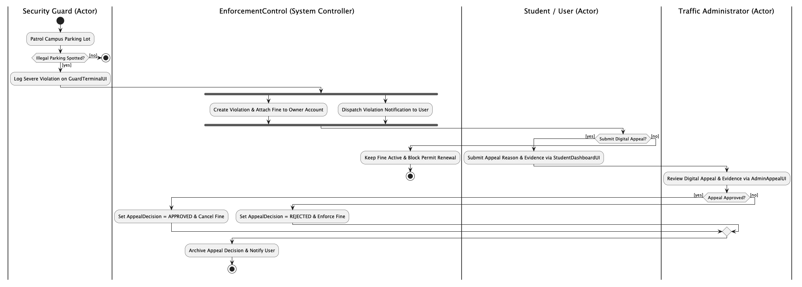
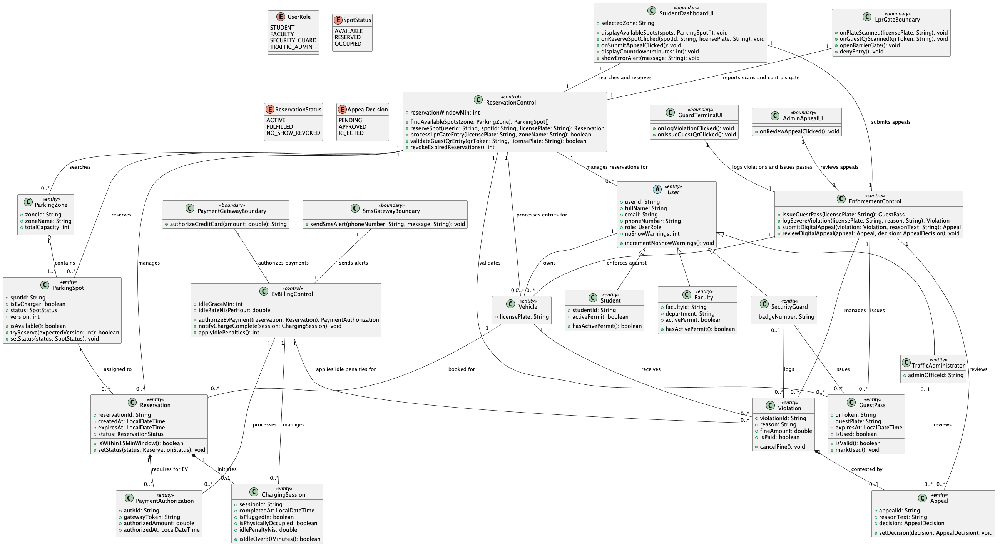
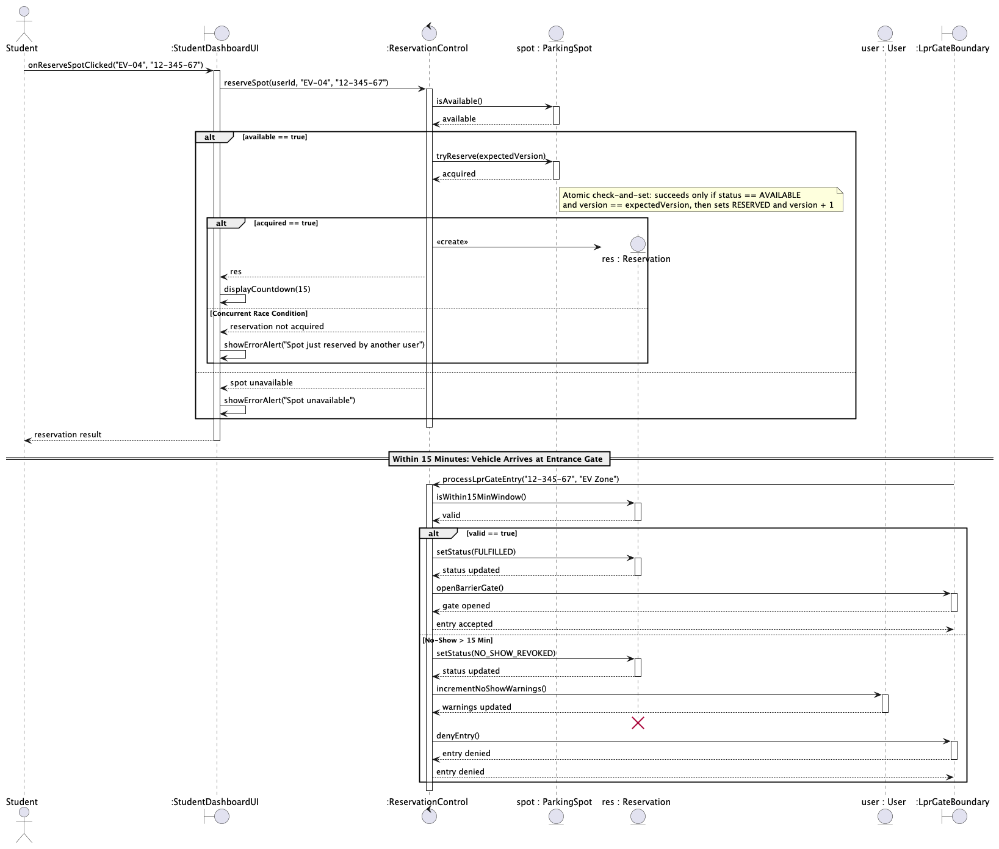
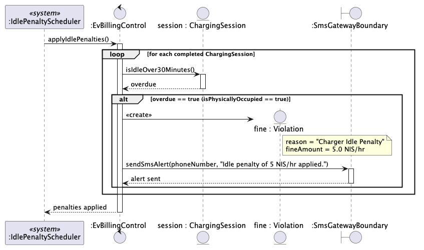

# System Architecture & Object-Oriented Design (`Ex4_SmartParking_Design`)

**Course:** 61756 Software Engineering Methods (Academic Year 2026-2027)
**Institution:** ORT Braude College of Engineering | Department of Software Engineering
**Domain:** Smart Campus Parking, LPR, and EV Network (Continued from Exercise 1)

---

## 1. Engineering Team Details

| Role | Full Name | Student ID | Braude Academic Email |
| :--- | :--- | :--- | :--- |
| **Student A (Role A)** | `Eden Krainits` | `211589742` | `eden.krainits@e.braude.ac.il` |
| **Student B (Role B)** | `Joe abou ghannam` | `322470998` | `joe.abou.ghannam@e.braude.ac.il` |

* **Group Number:** `G[XX]`
* **GitHub Repository URL:** `https://github.com/Edenkrayniz/Ex4_SmartParking_Design`

---

## 2. Step 1: Business Process Modeling — Activity Diagram (`Visual Paradigm`)

* **PlantUML Source:** [`diagrams/activity_appeal.puml`](diagrams/activity_appeal.puml)
* **Visual Paradigm Model:** [`SystemModel_Ex4.vpp`](SystemModel_Ex4.vpp)
* **Partitions / Swimlanes:** Separates external **Actors** (`Security Guard`, `Student / User`, `Traffic Administrator`) from the internal **System Controller** (`EnforcementControl`), using `initial node`, `fork`/`join` (AND), `decision` (XOR) with explicit `[guards]`, `merge` (OR), and `activity final node`.



---

## 3. Step 2: Structural Modeling — ECB Class Diagram (`PlantUML`)

Following the **ECB (Entity-Control-Boundary)** architectural pattern:

| ECB Stereotype | Classes in System | Architectural Responsibility |
| :--- | :--- | :--- |
| **`<<boundary>>`** | `StudentDashboardUI`, `GuardTerminalUI`, `AdminAppealUI`, `LprGateBoundary`, `PaymentGatewayBoundary`, `SmsGatewayBoundary` | Interfaces with external Actors and external hardware/payment/SMS systems. Communicates ONLY with `<<control>>` classes. |
| **`<<control>>`** | `ReservationControl`, `EvBillingControl`, `EnforcementControl` | Multiple specialized controllers orchestrating business rules, timers, concurrency checks, and workflows. |
| **`<<entity>>`** | `User` (`Student`, `Faculty`, `SecurityGuard`, `TrafficAdministrator`), `GuestPass`, `Vehicle`, `ParkingZone`, `ParkingSpot`, `Reservation`, `PaymentAuthorization`, `ChargingSession`, `Violation`, `Appeal` + 4 UML `enum`s | Passive domain data classes storing persistent business state and domain helper methods. |

* **PlantUML Source:** [`diagrams/class_diagram_ecb.puml`](diagrams/class_diagram_ecb.puml)
* **Iterative Refinement:** After modeling the sequence diagrams, three operation signatures were updated to match the messages exactly: `StudentDashboardUI.onReserveSpotClicked(spotId: String, licensePlate: String)`, `ReservationControl.reserveSpot(userId: String, spotId: String, licensePlate: String)`, and `ReservationControl.processLprGateEntry(licensePlate: String, zoneName: String)`.



---

## 4. Step 3: Behavioral Modeling — ECB Sequence Diagrams (`PlantUML`)

### 4.1 Sequence Diagram 1: Spot Reservation, LPR Gate Entry & No-Show Destruction
* **PlantUML Source:** [`diagrams/sequence_reservation_ecb.puml`](diagrams/sequence_reservation_ecb.puml)



### 4.2 Sequence Diagram 2: EV Charging 30-Minute Idle Penalty (`loop` & `<<create>>`)
* **PlantUML Source:** [`diagrams/sequence_idle_penalty_ecb.puml`](diagrams/sequence_idle_penalty_ecb.puml)



---

## 5. Independent AI Prompt & Architectural Design Critique (Part 4)

```text
You are a senior software architect reviewing our UML design for the Smart Campus Parking, LPR and EV Network system. Use the attached SYSTEM_STORY.md (especially Section 3), class_diagram_ecb.puml and sequence_reservation_ecb.puml.

Please audit our diagrams against these two edge cases:

Edge Case A - Double-booking race condition: two students click Reserve on the last available spot in the Student Zone at the exact same millisecond. Check whether our class diagram and Sequence Diagram 1 guarantee that only one reservation succeeds, and that the student who loses the race gets a clear error instead of a broken or duplicate reservation.

Edge Case B - Physical vs. electrical EV state: a driver unplugs the charging cable at minute 29 but leaves the car in the EV bay. Check whether our ChargingSession entity and the idle-penalty logic still apply the 30-minute Charger Idle Penalty in this case, based on physical occupancy and not only on the cable state.

For each edge case, tell us: (1) whether our current model handles it, (2) the exact gap if it does not, and (3) a concrete fix using class, attribute and method names. Then suggest at least one additional design improvement beyond these two cases. Keep the ECB rule in mind (boundary classes talk only to control classes), and answer as a short numbered list.
```

* **Improvement 1 Applied (Race Condition):** `ParkingSpot` keeps `version: int` and `tryReserve(expectedVersion: int): boolean`. Sequence Diagram 1 has a nested `alt acquired == true/false` and a note that defines `tryReserve` as an atomic check-and-set (it succeeds only if `status == AVAILABLE` and `version == expectedVersion`, then sets `RESERVED` and increments `version`), so only one of two simultaneous reservations succeeds.
* **Improvement 2 Applied (AI suggestion - No-Show Warnings):** Added `user : User` to Sequence Diagram 1 and an `incrementNoShowWarnings()` call in the No-Show branch, before the reservation is destroyed, as required by Section 2.2 of `SYSTEM_STORY.md`.
* **Verified (EV Physical Occupancy):** `ChargingSession` separates `isPluggedIn` from `isPhysicallyOccupied`, so unplugging the cable at minute 29 without moving the car still triggers the 30-minute Charger Idle Penalty.

---

## 6. License
Distributed under the **ORT Braude College Academic License** (61756 Software Engineering Methods, 2026-2027).